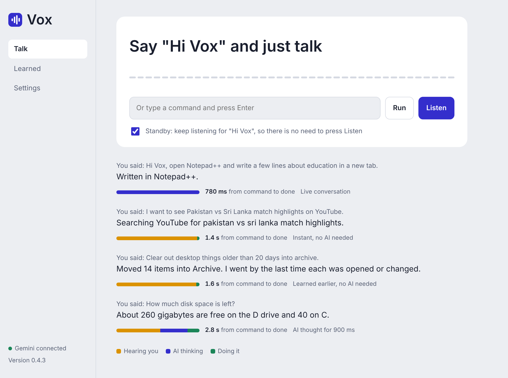
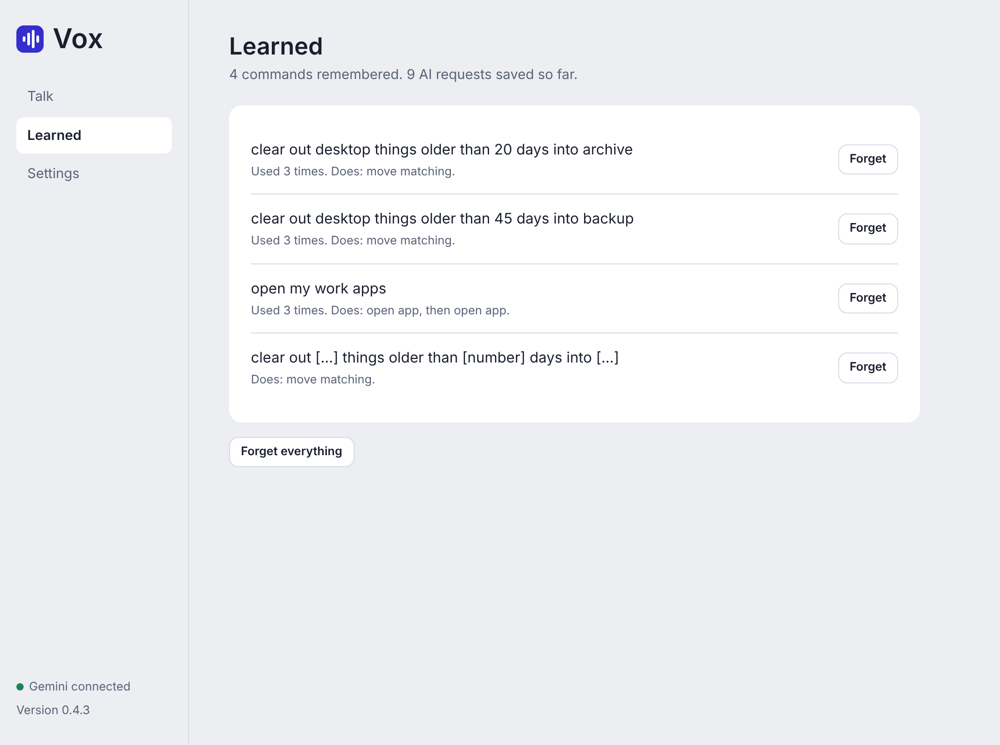
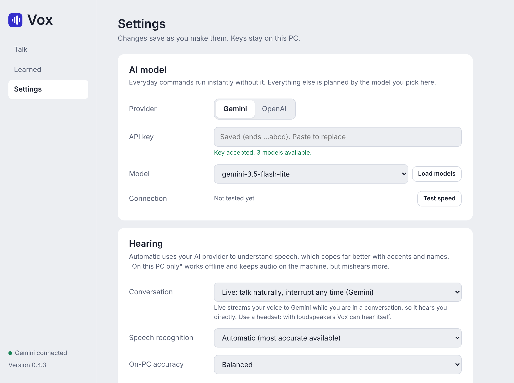

# Vox

A voice assistant that runs your Windows 11 PC. Say "Hi Vox" (or press a
hotkey), say what you want, and Vox does it and tells you what it did.

- "Open YouTube in Chrome and search for lofi beats"
- "Create a folder on the desktop and move everything not opened in 20 days into it"
- "Organise my desktop"
- "How much disk space is left?"
- "Undo that"

| Learned commands | Settings |
|---|---|
|  |  |

Screenshots are from version 0.4.3 with sample data.

## Install

1. Open the [latest release](https://github.com/nisar87/Vox/releases/latest)
   and download `VoxSetup-<version>.exe`.
2. Run it. Windows may show "Windows protected your PC" because the installer
   is not code-signed: choose **More info**, then **Run anyway**.
3. Vox opens. In **Settings**, choose Gemini or OpenAI, paste your API key,
   pick a model and press **Test speed**.

More detail, including first-run notes: [docs/INSTALL.md](docs/INSTALL.md).

## Using it

- Turn on **Standby** in Settings and say **"Hi Vox"**. It works with the
  window closed and goes quiet while you are on a call.
- Or press **Ctrl + Alt + Space** and speak. Vox stops listening when you stop.
- Or type into the window.
- "Open Notepad and keep writing what I say" starts dictation; "stop
  dictation" ends it.
- Vox asks before deleting, shutting down, reorganising a folder or running
  PowerShell. Answer "yes" or "no" by voice or with the buttons.
- Files are moved, never overwritten. "Undo that" puts them back.

## Why it is fast, and gets faster

Vox tries the cheapest route first:

| Route | When | AI request |
|---|---|---|
| Instant | Everyday commands: open a program or site, search, volume, media, lock, screenshot, undo | None |
| Learned | Anything the AI has planned for you before, and close variations of it | None |
| AI | Everything else. One request; the model returns every action at once | One |

The window shows, for every command, which route it took and how long
hearing, thinking and doing each took. See [docs/LEARNING.md](docs/LEARNING.md).

## Updating

Vox looks for a new version when it starts and shows **Update now** when
there is one. See [docs/UPDATING.md](docs/UPDATING.md).

## What is tested

Every change is tested on GitHub's machines before a release is published:

- Logic tests on Linux and Windows: router, planning engine, learning, file
  skills, undo, updater, settings server, Gemini and OpenAI adapters
  (against simulated replies).
- On Windows: real user folders, the Start menu index, opening and closing a
  real program, PowerShell.
- Spoken commands: Windows' voice speaks each command into a sound file, the
  speech model transcribes it, and the right action must be chosen.
- The installer is built, installed, started, and the installed copy runs
  its own self-test.

Not covered by the cloud tests, because those machines have no microphone,
speakers or API keys: capturing from a real microphone, the global hotkey
with a real keyboard, audible replies, volume changes, standby and dictation
with a live microphone, call detection during a real call, and live requests
to Gemini or OpenAI. Check these first on your PC.

## Documentation

- [Roadmap: what is done and what comes next](docs/ROADMAP.md)
- [Install and first run](docs/INSTALL.md)
- [Commands and skills](docs/COMMANDS.md)
- [How learning works](docs/LEARNING.md)
- [Updating](docs/UPDATING.md)
- [How it is built and released](docs/RELEASING.md)
- [Changelog](CHANGELOG.md)

## Privacy

API keys, settings, the undo journal and learned commands are stored on your
PC in `%APPDATA%\Vox`. With on-PC speech recognition, audio never leaves the
machine. The text of commands that need the AI is sent to the provider you
chose, along with the names of your installed programs and standard folders.
